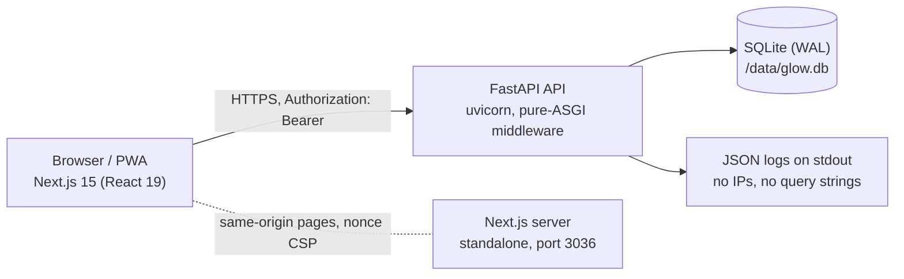

# Architecture

Roshana (روشنای باروری) is a Persian-first fertility tracker: cycle logging, a fertility-window predictor, a pregnancy guide, partner clinics and a support-fund sign-up. Two deployable parts, one database file.

## Backend (`backend/app`)

| Module | Responsibility |
|---|---|
| `config.py` | Typed settings. Refuses to start with a weak `SECRET_KEY` or a wildcard CORS list. |
| `db.py` | Async engine, SQLite pragmas (WAL, busy timeout, foreign keys), startup index migration. |
| `models.py` / `schemas.py` | Tables, and request/response models. Every client field has an explicit bound or enum. |
| `security.py` | bcrypt (run in a thread pool), PyJWT tokens, `current_user` and the rate-limited `writer` dependency. |
| `ratelimit.py` | In-memory sliding window. Rejects before any hashing work. |
| `middleware.py` | Security headers, request id, JSON access log, body-size limit, last-resort 500. Pure ASGI. |
| `errors.py` | One error envelope `{detail, code}`. Never echoes submitted values. |
| `routers/auth.py` | register, login, me, patch me, export, delete account |
| `routers/tracking.py` | cycles, daily logs (partial upsert), insights |
| `routers/care.py` | clinics, articles, pregnancy, support fund, community stats |
| `prediction.py` | Pure fertility engine (no I/O). Unit-tested. |

Request path: `SecurityMiddleware` → CORS → gzip → router → dependency (`current_user` / `writer`) → handler → session.

### Data model

`User 1—* Cycle`, `User 1—* DailyLog` (unique on `user_id, log_date`), `User 1—0..1 FundMembership`. `Clinic` and `Article` are shared editorial content. Deleting a user deletes all of their rows in one transaction.

### Decisions (ADR-style)

| Decision | Why | Revisit when |
|---|---|---|
| SQLite in WAL mode | One writer, tiny data, zero ops. | More than one API replica, or sustained write load. Move to Postgres; models are portable. |
| In-memory rate limiter | No new infrastructure for a single process. | Scaling out. Replace `_hits` with Redis. |
| Bearer token in `localStorage` | Frontend and API are separate origins; no CSRF surface. | Same-site deployment is possible. Move to an `HttpOnly` cookie plus CSRF token. See `red-team-report.md` F3. |
| bcrypt in a thread pool | The hash takes ~450 ms of CPU; it must not block the event loop. | Never needed to change. |
| Prediction uses the last 24 cycles and 120 days of logs | Recent data predicts better and bounds the cost. | If a feature needs long-term trends. |
| No background job queue | Nothing in the product is asynchronous or slow. | Reminders, e-mail or push notifications. |
| Client sends its local date (`?today=`) | Iran is UTC+3:30, so the UTC date is wrong for 3.5 hours a day. | Server stays tolerant to ±1 day. |

## Frontend (`frontend`)

Next.js App Router, all pages are client components behind `AppShell`. `middleware.ts` mints a per-request nonce and sets a strict CSP; the root layout reads it, so pages render dynamically.

| Area | Files |
|---|---|
| Shell and navigation | `components/shell.tsx` (desktop sidebar, mobile tab bar with a More sheet) |
| Design primitives | `components/ui.tsx` (springs, Card, Button, Skeleton, ErrorState), `app/globals.css` |
| State | `components/providers.tsx` (locale, theme, session, reduced motion) |
| API client | `lib/api.ts` (typed errors, auto sign-out on expired token), `lib/hooks.ts` (`useLoad`) |
| Dates and numbers | `lib/date.ts` (local dates, Persian digit normalisation), `lib/i18n.ts` |
| Offline | `public/sw.js` (versioned cache, cleared on sign-out) |

## Runtime topology

Docker Compose runs two services on the loopback interface. Both run as non-root, with a read-only root filesystem, no capabilities, no privilege escalation, memory/CPU/PID limits and rotated logs. The only writable paths are the `/data` volume and small tmpfs mounts. Put a TLS reverse proxy in front for public use (see `deployment.md`).
