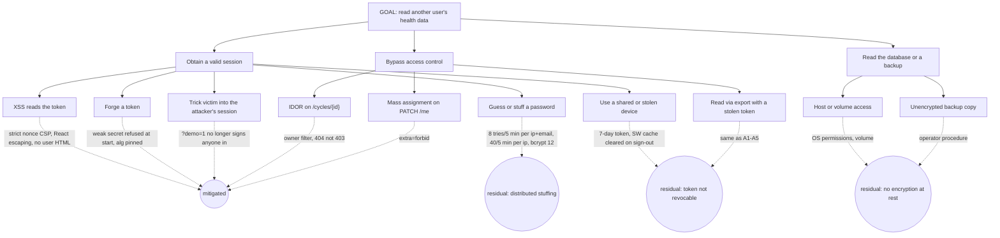
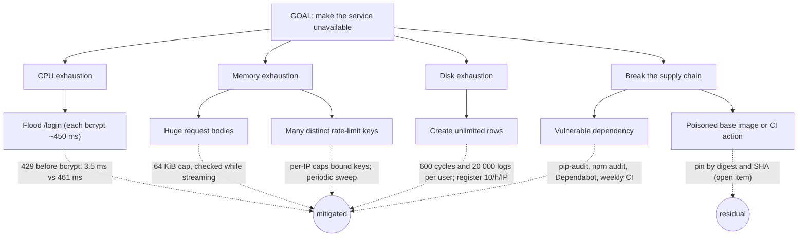

# Threat model and attack trees

Scope: the API, the web app/PWA, the SQLite file and the container runtime. Data class: **special-category health data** (cycle dates, temperatures, intercourse, mood, pregnancy), so confidentiality matters more than availability.

## Assets and trust boundaries

| Asset | Where | Who must not touch it |
|---|---|---|
| Cycle and daily-log rows | SQLite `/data/glow.db` | Anyone but the owning user |
| Session token | Browser `localStorage` | Scripts not served by us |
| `SECRET_KEY` | Environment | Everyone but the operator |
| Account credentials | bcrypt hashes in the `user` table | Everyone |

Boundaries: Internet → reverse proxy → Next.js and API; browser → API (cross-origin); API → SQLite volume.

## STRIDE summary

| | Threat | Control | Test / evidence |
|---|---|---|---|
| **S**poofing | Forged or stolen token, credential stuffing | HS256 pinned, required claims, strong secret enforced at start, rate limits, bcrypt 12 | `test_s2`, `test_s3_*`, `test_s7_*` |
| **T**ampering | Overwriting another user's rows, mass assignment | Every query filtered by `user_id`; `extra="forbid"` on updates; enums and bounds | `test_control_idor_*`, `test_control_mass_assignment_*` |
| **R**epudiation | "I never did that" | Request id on every response and log line | `test_health_ready_and_request_ids` |
| **I**nformation disclosure | Verbose errors, logs, CORS, enumeration | Error envelope, no IP/query/body logging, explicit CORS, timing equalised | `test_error_responses_*`, `test_s1_*`, `test_s4_*` |
| **D**enial of service | bcrypt flood, huge bodies, unbounded rows | Throttle before hashing, 64 KiB body cap, per-user caps, WAL | `test_s3_*`, `test_oversized_*`, `test_s9_cycle_rows_*` |
| **E**levation | Reaching admin or docs endpoints | No admin surface; docs off unless `APP_ENV=dev` | `test_s13_*` |

## Attack tree: read another person's health data

### Leaf annotations

| Leaf | Cost | Skill | Detectability | Priority |
|---|---|---|---|---|
| Distributed credential stuffing | Medium (botnet) | Low | Medium (many 401s, 429s in logs) | **High**: add per-account lock-out signal and breach-password check |
| XSS → token theft | High (needs an injection bug first) | High | Low | Medium: CSP is the main control |
| Stolen device | Low | Low | None | Medium: add "sign out all devices" (needs token versioning) |
| Database or backup copy | Low if host is compromised | Medium | Low | **High** for a health product: encrypt the volume and backups |
| Token forgery | Very high once the secret is strong | High | Medium | Low |

## Attack tree: take the service down

## Abuse of the predictor (safety)

A wrong prediction can change a medical decision. Controls: inputs are bounded (temperature 34–42 °C, dates in range), the confidence score is always shown, the UI states that the prediction does not replace a doctor, and the referral rule uses the caller's date.
